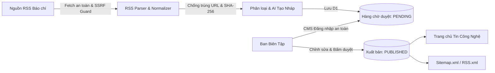

# TIN CÔNG NGHỆ AI — AUTOMATED NEWSROOM

Website tin tức công nghệ tiếng Việt chuẩn báo điện tử truyền thống, tích hợp quy trình thu thập RSS tự động, AI biên soạn bản nháp (Human-in-the-loop), CMS quản trị duyệt bài phân cấp và triển khai hoàn toàn trên **Cloudflare Pages & D1** với **chi phí vận hành 0 đồng** trong hạn mức miễn phí.

---

## MỤC LỤC HƯỚNG DẪN TRIỂN KHAI

1. [Tổng quan Kiến trúc](#1-tổng-quan-kiến-trúc)
2. [Yêu cầu Môi trường](#2-yêu-cầu-môi-trường)
3. [Cài đặt và Chạy Thử nghiệm Cục bộ (Local Development)](#3-cài-đặt-và-chạy-thử-nghiệm-cục-bộ)
4. [Khởi tạo Cơ sở Dữ liệu Cloudflare D1](#4-khởi-tạo-cơ-sở-dữ-liệu-cloudflare-d1)
5. [Cập nhật Cấu hình và Database ID](#5-cập-nhật-cấu-hình-và-database-id)
6. [Thực thi Database Migrations (Local & Remote)](#6-thực-thi-database-migrations)
7. [Tạo Mã Quản trị Bí mật (ADMIN_TOKEN & Session Secret)](#7-tạo-mã-quản-trị-bí-mật)
8. [Cấu hình Biến Môi trường (Environment Variables & Secrets)](#8-cấu-hình-biến-môi-trường)
9. [Cấu hình Cloudflare Workers AI](#9-cấu-hình-cloudflare-workers-ai)
10. [Deploy lên Cloudflare Pages](#10-deploy-lên-cloudflare-pages)
11. [Thiết lập Tự động Deploy qua GitHub](#11-thiết-lập-tự-động-deploy-qua-github)
12. [Cấu hình Lịch Thu thập Tin RSS Tự động (Cron Triggers)](#12-cấu-hình-lịch-thu-thập-tin-rss-tự-động)
13. [Kiểm tra URL Production và Hoạt động Hệ thống](#13-kiểm-tra-url-production)
14. [Cấu hình Tên miền Riêng (Custom Domain)](#14-cấu-hình-tên-miền-riêng)
15. [Thiết lập SEO, Google Search Console và Sitemap](#15-thiết-lập-seo-search-console-và-sitemap)
16. [Chuẩn bị và Kích hoạt Google AdSense](#16-chuẩn-bị-và-kích-hoạt-google-adsense)
17. [Sao lưu và Phục hồi Database (Backup & Restore D1)](#17-sao-lưu-và-phục-hồi-database)
18. [Xử lý Các Lỗi Thường Gặp (Troubleshooting)](#18-xử-lý-các-lỗi-thường-gặp)

---

## 1. TỔNG QUAN KIẾN TRÚC

- **Frontend:** Server-Side Rendered (SSR) bằng Hono trên Cloudflare Edge, tối ưu hóa First Contentful Paint (FCP), Core Web Vitals và SEO. Giao diện báo chí tiếng Việt truyền thống, responsive 100%.
- **Backend & API:** Cloudflare Pages Functions (`functions/[[path]].ts`), kiến trúc chuẩn RESTful API, bảo mật đa tầng, chống SSRF, chống XSS, kiểm soát kích thước body (< 512KB).
- **Cơ sở dữ liệu:** Cloudflare D1 (SQLite phân tán toàn cầu tại Edge).
- **Trí tuệ nhân tạo (AI):** Cloudflare Workers AI (`@cf/meta/llama-3.1-8b-instruct`), kèm chế độ dự phòng (fallback) tạo nháp từ metadata nguồn nếu AI hết hạn mức hoặc mất kết nối.
- **Thu thập tin tức (Ingestion):** Parser XML RSS 2.0 & Atom thuần JavaScript, chuẩn hóa URL, bóc tách tracking params, khử trùng lặp theo canonical URL và hàm băm SHA-256 tiêu đề.
- **Quy tắc cốt lõi:** **100% bản nháp mới vào hàng chờ `pending`**. Không một API nào tự động xuất bản bài viết mà không có phê duyệt từ quản trị viên.



---

## 2. YÊU CẦU MÔI TRƯỜNG

- **Node.js:** Phiên bản `>= 20.0.0` (khuyên dùng Node.js 22 LTS hoặc 24).
- **Trình quản lý gói:** `npm` (đi kèm Node.js).
- **Tài khoản Cloudflare:** Gói Free (miễn phí) hoàn toàn đủ hạn mức:
  - Cloudflare Pages: Không giới hạn băng thông và số lượng yêu cầu miễn phí.
  - Cloudflare D1: 5 triệu lượt đọc/tháng, 100,000 lượt ghi/tháng miễn phí.
  - Cloudflare Workers AI: 10,000 Neurons/ngày miễn phí (hoặc chạy chế độ dự phòng metadata 0 đồng).
- **Git:** Đã cài đặt trên máy.

---

## 3. CÀI ĐẶT VÀ CHẠY THỬ NGHIỆM CỤC BỘ

### Bước 3.1: Clone repository và cài đặt thư viện
```bash
git clone https://github.com/<your-username>/tin-cong-nghe-ai.git
cd tin-cong-nghe-ai
npm install
```

### Bước 3.2: Chạy kiểm thử tự động (Unit & Integration Tests)
Hệ thống đã viết sẵn 36 bài kiểm thử toàn diện:
```bash
npm test
```

### Bước 3.3: Khởi chạy môi trường phát triển cục bộ
```bash
npm run dev
```
Trang web sẽ chạy tại: `http://localhost:8788`

---

## 4. KHỞI TẠO CƠ SỞ DỮ LIỆU CLOUDFLARE D1

Đăng nhập tài khoản Cloudflare qua CLI Wrangler:
```bash
npx wrangler login
```

Tạo cơ sở dữ liệu D1 mang tên `tin-cong-nghe-db`:
```bash
npx wrangler d1 create tin-cong-nghe-db
```

Wrangler sẽ in ra thông tin cấu hình tương tự như sau:
```toml
[[d1_databases]]
binding = "DB"
database_name = "tin-cong-nghe-db"
database_id = "xxxxxxxx-xxxx-xxxx-xxxx-xxxxxxxxxxxx"
```

---

## 5. CẬP NHẬT CẤU HÌNH VÀ DATABASE ID

Mở tệp `wrangler.toml` trong thư mục gốc dự án và thay thế `database_id` bằng ID thực tế bạn vừa nhận được:

```toml
[[d1_databases]]
binding = "DB"
database_name = "tin-cong-nghe-db"
database_id = "xxxxxxxx-xxxx-xxxx-xxxx-xxxxxxxxxxxx"
```

---

## 6. THỰC THI DATABASE MIGRATIONS

Hệ thống quản lý schema bằng các tệp migration tuần tự trong thư mục `migrations/`:
- `migrations/0001_initial_schema.sql`: Khởi tạo bảng `articles`, `feeds`, `ingestion_runs`, `audit_logs` và các indexes.
- `migrations/0002_seed_feeds.sql`: Nạp sẵn các nguồn RSS công nghệ chuẩn (VnExpress, Tuổi Trẻ, Thanh Niên, VietNamNet, Ars Technica).

### Chạy migrations trên môi trường cục bộ (Local):
```bash
npx wrangler d1 migrations apply tin-cong-nghe-db --local
```

### Chạy migrations trên Cloudflare Production (Remote):
```bash
npx wrangler d1 migrations apply tin-cong-nghe-db --remote
```

---

## 7. TẠO MÃ QUẢN TRỊ BÍ MẬT

Tạo chuỗi token ngẫu nhiên bảo mật cao (entropy cao) để đăng nhập vào trang CMS Tòa soạn:

Trên Linux/macOS hoặc Git Bash:
```bash
openssl rand -hex 32
```
Hoặc trên PowerShell:
```powershell
-join ((65..90) + (97..122) + (48..57) | Get-Random -Count 48 | ForEach-Object {[char]$_})
```

Ví dụ kết quả nhận được: `7a9e3f1c8b2d4e6f0a1c3e5b7d9f2a4c6e8b0d2f4a6c8e0b2d4f6a8c0e2b4d6f`

---

## 8. CẤU HÌNH BIẾN MÔI TRƯỜNG

### Cấu hình cục bộ (Local)
Tạo file `.env` từ `.env.example`:
```bash
cp .env.example .env
```
Điền các giá trị của bạn:
```ini
SITE_NAME="Tin Công Nghệ"
SITE_DESCRIPTION="Thời báo Trí tuệ nhân tạo & Công nghệ số"
CANONICAL_ORIGIN="http://localhost:8788"
ADMIN_TOKEN="<Chuỗi_token_bước_7>"
ADMIN_SESSION_SECRET="<Chuỗi_secret_ngẫu_nhiên_32_ký_tự>"
CRON_SECRET="<Chuỗi_secret_bảo_vệ_cron>"
AI_MODEL="@cf/meta/llama-3.1-8b-instruct"
FALLBACK_TO_METADATA="true"
ADSENSE_ENABLED="false"
ADSENSE_CLIENT=""
```

### Cấu hình trên Cloudflare Dashboard (Production)
1. Đăng nhập [Cloudflare Dashboard](https://dash.cloudflare.com)
2. Vào **Workers & Pages** > Chọn dự án Pages của bạn (`tin-cong-nghe-ai`).
3. Chuyển sang thẻ **Settings** > **Environment variables**.
4. Thêm các biến môi trường và thiết lập dưới dạng **Encrypted / Secret**:
   - `ADMIN_TOKEN`: Mật mã đăng nhập CMS.
   - `ADMIN_SESSION_SECRET`: Khóa mã hóa Cookie HttpOnly.
   - `CRON_SECRET`: Khóa bảo vệ endpoint `/api/cron/ingest`.
   - `CANONICAL_ORIGIN`: URL chính thức của bạn (ví dụ `https://tincongnghe.pages.dev`).

---

## 9. CẤU HÌNH CLOUDFLARE WORKERS AI

Tài khoản miễn phí của Cloudflare cho phép sử dụng binding Workers AI:
1. Trong file `wrangler.toml`, phần cấu hình AI đã được tích hợp sẵn:
   ```toml
   [ai]
   binding = "AI"
   ```
2. Trên Cloudflare Pages Dashboard: Vào **Settings** > **Functions** > **Workers AI bindings** > Thêm binding tên `AI`.
3. **Cơ chế Fallback an toàn:** Nếu tài khoản của bạn chưa kích hoạt AI hoặc vượt quá giới hạn lượt dùng trong ngày (10,000 Neurons/ngày), hệ thống **tự động chuyển sang chế độ tạo bản nháp từ metadata**, gắn cảnh báo `Cần kiểm chứng` và tuyệt đối không làm dừng tiến trình của bạn!

---

## 10. DEPLOY LÊN CLOUDFLARE PAGES

### Cách 1: Deploy trực tiếp qua Wrangler CLI
```bash
npm run build
npx wrangler pages deploy public --project-name tin-cong-nghe-ai
```

### Cách 2: Deploy qua Git Push (Khuyên dùng)
Xem tiếp mục 11.

---

## 11. THIẾT LẬP TỰ ĐỘNG DEPLOY QUA GITHUB

1. Tạo một repository mới trên GitHub (ví dụ: `tin-cong-nghe-ai`).
2. Đẩy mã nguồn từ máy lên GitHub:
   ```bash
   git add .
   git commit -m "feat: complete automated newsroom on Cloudflare Pages"
   git remote add origin https://github.com/<your-username>/tin-cong-nghe-ai.git
   git branch -M main
   git push -u origin main
   ```
3. Truy cập **Cloudflare Dashboard** > **Workers & Pages** > **Create application** > **Pages** > **Connect to Git**.
4. Chọn repository GitHub vừa tạo.
5. Thiết lập Build Settings:
   - **Framework preset:** `None`
   - **Build command:** `npm run build`
   - **Build output directory:** `public`
6. Nhấn **Save and Deploy**. Cloudflare sẽ tự động build và cấp phát URL dạng: `https://<ten-du-an>.pages.dev`.

---

## 12. CẤU HÌNH LỊCH THU THẬP TIN RSS TỰ ĐỘNG

Có 2 phương thức kích hoạt pipeline lấy tin RSS:

### Cách A: Kích hoạt thủ công từ CMS (Bất kỳ lúc nào)
- Đăng nhập vào `/admin`
- Nhấn nút **⚡ Lấy tin RSS ngay** trên thanh điều hướng.
- Hệ thống sẽ hiển thị kết quả: Số tin quét được, số bản nháp mới thêm vào `pending`, số tin trùng lặp bị bỏ qua.

### Cách B: Lập lịch tự động bằng Cloudflare Worker Cron Trigger (Đã kèm sẵn trong repo)
Thư mục `worker-cron/` chứa một Worker siêu nhẹ chuyên trách việc kích hoạt lịch:
1. Mở file `worker-cron/wrangler.toml`:
   ```toml
   name = "tin-cong-nghe-cron"
   main = "index.ts"
   compatibility_date = "2024-04-03"

   [triggers]
   crons = ["0 */2 * * *"] # Chạy tự động mỗi 2 giờ (hoặc tùy chỉnh)

   [vars]
   PAGES_API_URL = "https://<your-project>.pages.dev/api/cron/ingest"
   CRON_SECRET = "<chuỗi_CRON_SECRET_của_bạn>"
   ```
2. Deploy worker cron:
   ```bash
   cd worker-cron
   npx wrangler deploy
   ```
Endpoint `/api/cron/ingest` được bảo mật bằng mã bí mật `CRON_SECRET` và có cơ chế chống chạy trùng (Concurrency Lock) nếu có tiến trình khác đang thực thi trong vòng 5 phút.

---

## 13. KIỂM TRA URL PRODUCTION

Sau khi deploy, truy cập các URL để xác minh:
- **Trang chủ:** `https://<ten-du-an>.pages.dev/`
- **Sitemap XML:** `https://<ten-du-an>.pages.dev/sitemap.xml` (Chỉ chứa bài `published`)
- **RSS Feed:** `https://<ten-du-an>.pages.dev/rss.xml`
- **Robots.txt:** `https://<ten-du-an>.pages.dev/robots.txt`
- **Ads.txt:** `https://<ten-du-an>.pages.dev/ads.txt`
- **Trang Đăng nhập CMS:** `https://<ten-du-an>.pages.dev/admin/login`

---

## 14. CẤU HÌNH TÊN MIỀN RIÊNG (CUSTOM DOMAIN)

1. Nếu bạn có tên miền riêng (ví dụ `tincongnghe.vn` hoặc `congnghe.com`):
2. Vào Cloudflare Pages > Chọn dự án > **Custom domains** > **Set up a custom domain**.
3. Điền tên miền của bạn và làm theo hướng dẫn trỏ DNS (Cloudflare tự động cấp phát chứng chỉ SSL/TLS miễn phí 100%).
4. Cập nhật biến môi trường `CANONICAL_ORIGIN="https://tenmiencuaban.com"`.

---

## 15. THIẾT LẬP SEO, GOOGLE SEARCH CONSOLE VÀ SITEMAP

1. Truy cập [Google Search Console](https://search.google.com/search-console).
2. Thêm thuộc tính URL: `https://<ten-du-an>.pages.dev` (hoặc tên miền riêng).
3. Vào mục **Sitemaps** (Sơ đồ trang web) > Nhập `sitemap.xml` > Nhấn **Gửi (Submit)**.
4. Mọi bài viết sau khi được biên tập viên bấm **Duyệt & Xuất bản** sẽ lập tức xuất hiện trong `sitemap.xml` với thẻ `<lastmod>` chính xác, hỗ trợ bot Google thu thập tức thì.
5. Mỗi bài viết đã được nhúng sẵn cấu trúc dữ liệu chuẩn Schema.org `NewsArticle` dạng JSON-LD, thẻ OpenGraph và Twitter Card.

---

## 16. CHUẨN BỊ VÀ KÍCH HOẠT GOOGLE ADSENSE

Xem hướng dẫn đầy đủ tại [ADSENSE_CHECKLIST.md](./ADSENSE_CHECKLIST.md).
- Mặc định hệ thống để chế độ placeholder an toàn cho môi trường thử nghiệm.
- Khi được duyệt, chỉ cần điền `ADSENSE_ENABLED = "true"` và `ADSENSE_CLIENT = "ca-pub-XXXXXXXXXXXXXXXX"` vào biến môi trường Cloudflare.
- Endpoint `/ads.txt` sẽ tự động kích hoạt mã nhà xuất bản chính thức.

---

## 17. SAO LƯU VÀ PHỤC HỒI DATABASE

### Sao lưu (Export / Backup):
```bash
npx wrangler d1 export tin-cong-nghe-db --remote --output="./backup_$(date +%Y%m%d).sql"
```

### Phục hồi (Import / Restore):
```bash
npx wrangler d1 execute tin-cong-nghe-db --remote --file="./backup_20251020.sql"
```

---

## 18. XỬ LÝ CÁC LỖI THƯỜNG GẶP (TROUBLESHOOTING)

### Lỗi 1: `D1_ERROR: no such table: articles`
- **Nguyên nhân:** Chưa chạy migration trên database remote.
- **Khắc phục:** Chạy lệnh: `npx wrangler d1 migrations apply tin-cong-nghe-db --remote`.

### Lỗi 2: Không đăng nhập được vào CMS `/admin/login`
- **Nguyên nhân:** Mã `ADMIN_TOKEN` chưa được cấu hình hoặc nhập sai.
- **Khắc phục:** Kiểm tra biến môi trường `ADMIN_TOKEN` trong Cloudflare Pages Settings. Đảm bảo không có khoảng trắng thừa ở đầu/cuối token.

### Lỗi 3: Nguồn RSS báo lỗi `Chặn URL không an toàn`
- **Nguyên nhân:** Hệ thống SSRF Guard đã chặn các địa chỉ IP nội bộ (localhost, 127.0.0.1, 192.168.x, 10.x).
- **Khắc phục:** Chỉ cung cấp các URL RSS công khai bắt đầu bằng `https://` hoặc `http://` từ các cơ quan báo chí hợp pháp.

### Lỗi 4: AI không phản hồi hoặc trả về tiếng Anh
- **Nguyên nhân:** Hạn mức Workers AI miễn phí đạt ngưỡng trong ngày.
- **Khắc phục:** Hệ thống tự động chuyển sang chế độ dự phòng (fallback) từ metadata gốc, gắn cờ `Cần kiểm chứng` và bảo toàn 100% dữ liệu để bạn tiếp tục biên tập thủ công mà không bị gián đoạn.
